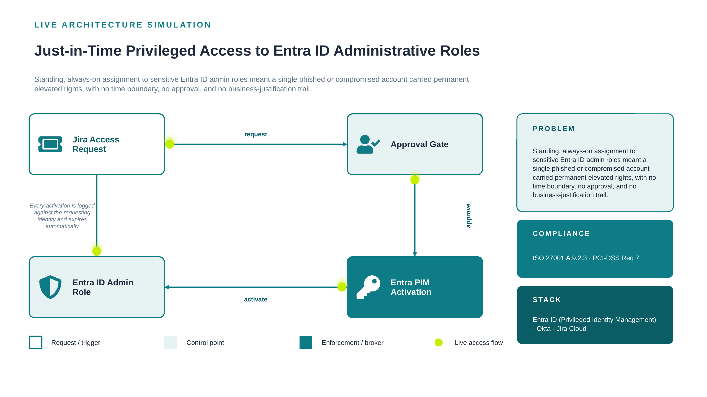

# 02. Just-in-Time Privileged Access to Entra ID Administrative Roles

**Classification:** Internal Use - Portfolio Demonstration
**Control Owner:** Privileged Access Management (PAM)
**Document Status:** Approved
**Last Reviewed:** 2026-08-21
**Review Cadence:** Annual, or upon material architecture change

---

## 1. Executive Summary

Standing, always-on assignment to sensitive Entra ID admin roles meant a single phished or compromised account carried permanent elevated rights, with no time boundary, no approval, and no business-justification trail. This document set describes the control designed and implemented to remediate that exposure, the residual risk accepted following implementation, and the evidence required to demonstrate the control is operating effectively.

## 2. Scope

This control applies to the identity and access systems described in Section 4 (Architecture) and the compliance requirements listed in Section 5. It does not extend to systems outside the stack listed below without a documented scope-extension review.

**In-scope systems:** Entra ID (Privileged Identity Management), Okta, Jira Cloud

## 3. Risk Statement

**Inherent risk (pre-control):** Standing privileged access to Entra ID administrative roles represents a critical single point of compromise; a single stolen credential could grant unrestricted directory-wide administrative access with no compensating control.

**Residual risk (post-control):** Low. Activation requires MFA, a documented business justification, and human approval, and expires automatically at the end of the configured activation window. Residual risk is limited to approval fatigue under high request volume, mitigated by periodic access-pattern review via the linked Access Review.

## 4. Architecture



Full architecture rationale, alternatives considered, and consequences are documented in [`architecture/decision-record.md`](architecture/decision-record.md).

*Diagram legend: white/outlined nodes are the request trigger, tinted nodes are control points, solid-filled nodes are the enforcement/broker layer. The dashed loop shows the audit/feedback path back to the system of record.*

## 5. Compliance Mapping

| Requirement | Description |
|---|---|
| ISO 27001 A.9.2.3 | Management of privileged access rights |
| PCI-DSS Req 7 | Restrict access by business need to know |

Full control testing procedure and evidence requirements are documented in [`compliance/compliance-mapping.md`](compliance/compliance-mapping.md).

## 6. Governing Policy

Formal, auditable policy statements for this control are documented in [`policies/access-control-policy.md`](policies/access-control-policy.md). All numbered statements use normative "shall" language consistent with ISO 27001 Annex A documentation conventions.

## 7. Evidence & Screenshots

This repository does not ship placeholder screenshots. [`screenshots/SCREENSHOTS_NEEDED.md`](screenshots/SCREENSHOTS_NEEDED.md) defines the exact evidence an auditor or control tester would expect to see, mapped to each implementation step.

## 8. Directory Structure

```
02-jit-privileged-access-entra-pim/
├── README.md                      <- this document
├── architecture/
│   ├── architecture.png
│   └── decision-record.md         <- ADR: context, decision, alternatives, consequences
├── compliance/
│   └── compliance-mapping.md      <- control objective, testing procedure, evidence, residual risk
├── policies/
│   └── access-control-policy.md   <- formal policy statements, roles, exceptions, enforcement
├── screenshots/
│   └── SCREENSHOTS_NEEDED.md      <- evidence capture checklist
└── .gitattributes
```

## 9. Lessons Learned

Entra ID PIM's audit history log is a genuinely strong single evidence artifact - it captures the entire chain (justification, approver, timestamps) in one native, unforgeable record, with far less custom engineering than the equivalent bespoke approval workflow would have needed.

---

[⬅ Back to portfolio index](../README.md)
